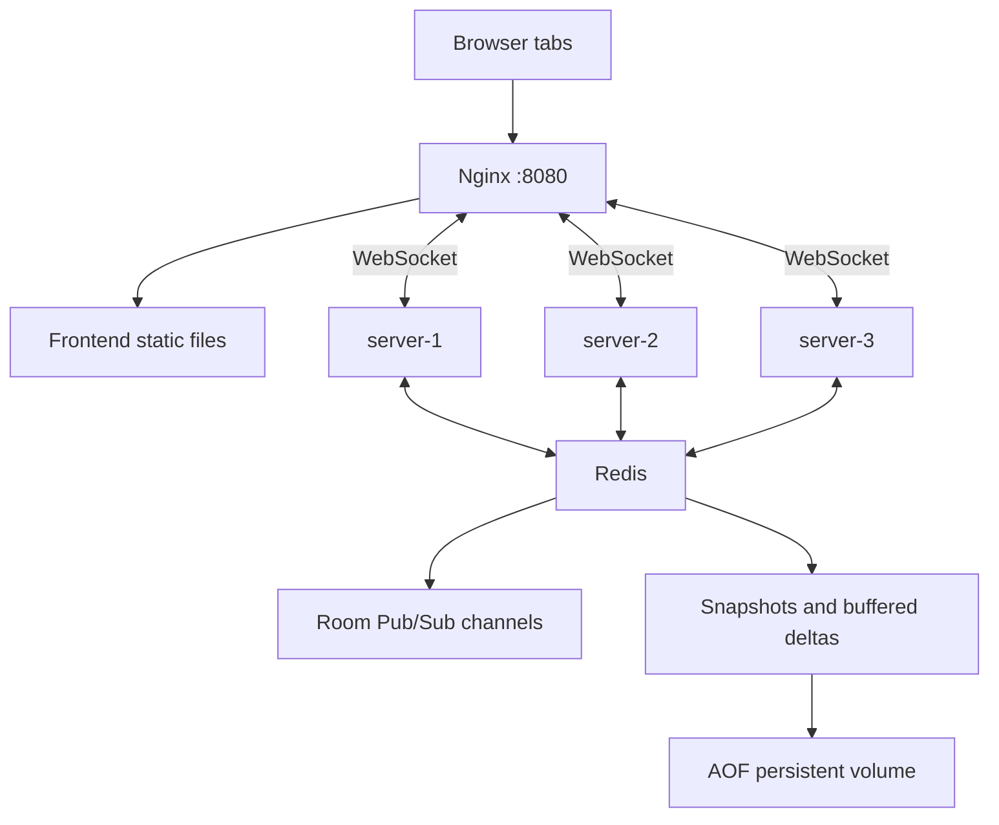

# Common Canvas - Real-Time Collaborative Whiteboard

A college-level distributed systems project with a Canvas frontend, three Node.js / Express / `ws` replicas, Nginx, and a Redis Pub/Sub backplane. Open the same room in multiple tabs and draw together.

## Step 1 - Folder structure and architecture

```text
Collaborative Whiteboard/
  docker-compose.yml
  nginx.conf
  README.md
  .gitignore
  backend/
    Dockerfile
    .dockerignore
    package.json
    src/
      server.js            HTTP health, WebSockets, Pub/Sub, recovery
      protocol.js          Room and message validation
      store.js             Atomic Redis Lua scripts
    test/
      protocol.test.js     Input validation tests
      integration.js       Full-stack synchronization tests
  frontend/
    Dockerfile
    nginx.conf             Static serving and /room/* fallback
    index.html
    style.css
    app.js                 Canvas, tools, cursors, reconnect, metrics
```



Nginx balances **new connections** using round-robin. An established WebSocket remains attached to its chosen replica. All replicas subscribe to `whiteboard:*`; they deliver events only to local clients in the matching room. This pattern subscription is simple for three demo replicas; a larger deployment should subscribe only to rooms with local members.

## Step 2 - Deployment

Prerequisites: Docker Engine / Docker Desktop running with Linux containers and Docker Compose. Node.js 22 is only needed for running tests outside containers.

From this project directory:

```sh
docker compose up --build -d
docker compose ps
```

The older Compose spelling also works if installed:

```sh
docker-compose up --build -d
```

Open **http://localhost:8080/room/cs101**. Change the Room field to create or join another room. Rooms are created lazily on the first edit; room IDs allow 1-48 letters, digits, underscores or hyphens.

Only port 8080 is exposed. Nginx explicitly forwards HTTP/1.1 `Upgrade` and `Connection` headers, disables proxy buffering for sockets, and retries failed handshakes against healthy replicas. Docker DNS resolution refreshes upstream addresses. A 20-second WebSocket heartbeat detects dead peers and keeps idle connections alive.

```sh
docker compose logs -f server-1 server-2 server-3
docker compose down
```

Stopping the stack preserves the Redis volume. `docker compose down -v` deliberately deletes all stored boards.

## Step 3 - Backend and state recovery

### Message flow

1. A client sends a validated drawing delta to its attached replica.
2. A Redis Lua script checks the event ID, allocates a monotonically increasing room sequence number, appends the event to the room tail, and publishes it to `whiteboard:<roomId>` in a single atomic operation.
3. Every replica receives the publication. Each forwards it to its own clients in that room, including the originating client.
4. The sender also receives an acknowledgement. It retains unacknowledged edits in browser memory and retries them after reconnecting. Redis deduplicates those retries by event ID.

Example outbound delta (coordinates normalized to `[0,1]`):

```json
{"roomId":"cs101","type":"draw","id":"unique-event-id","x0":0.1,"y0":0.2,"x1":0.3,"y1":0.4,"color":"#4f46e5","size":4,"tool":"pen"}
```

The server derives the room from the WebSocket connection and assigns the user ID itself; it does not trust client-supplied identity. Drawing size uses a canonical 1600x900 canvas. The eraser uses `destination-out`, so it removes ink while retaining the grid background.

### Snapshot design

| Redis key | Contents |
| --- | --- |
| `wb:{cs101}:seq` | Latest committed room revision |
| `wb:{cs101}:snapshot` | Ordered vector commands in the latest checkpoint |
| `wb:{cs101}:tail` | Commands committed after the checkpoint |
| `wb:{cs101}:seen` | Event ID  revision mapping for retry deduplication |
| `whiteboard:cs101` | Ephemeral Pub/Sub channel |

Every 10 seconds, replicas with local room members atomically move the buffered tail into the snapshot. Concurrent checkpoint attempts are harmless because Redis serializes the Lua scripts. This is a **vector snapshot**, not a PNG: replaying the ordered commands recreates the image exactly. The checkpoint reduces the recovery tail but does not compress the full drawing history.

A joining client is registered for live events before its state is read. The server buffers publications during an atomic read of snapshot, tail and sequence. It sends the state first, followed by buffered events newer than that state. The client ignores old revisions and requests state on a sequence gap. A three-second reconciliation also repairs a missed final event when no later publication arrives.

Clear-board is an ordered durable command. It atomically removes old drawing history, appends a clear event, and preserves the room's revision counter and deduplication IDs. Retrying an old edit after a clear therefore does not resurrect it.

### Failure behavior and limits

- **Backend failure:** browser reconnects with exponential backoff and jitter (up to roughly 10 seconds), Nginx selects a surviving replica, and the board reloads from Redis. Drawing is disabled while disconnected. Unacknowledged edits survive a socket reconnect in the same page, not a page refresh or browser crash.
- **Pub/Sub loss:** durable room state repairs missed drawing events. Cursors are ephemeral and may be dropped; stale cursor labels expire after five seconds.
- **Redis failure:** edits fail closed until Redis returns. This stack has a single Redis primary; it is not highly available. Redis AOF with `appendfsync everysec` can lose approximately the last second of writes on a host crash. Atomic Redis execution is not a claim of crash-proof, end-to-end exactly-once delivery.
- **Storage:** room keys expire after 24 hours without an accepted new edit. A room supports up to 20,000 retained drawing/clear commands; clear the board to reset history. Deduplication metadata remains until room expiry and grows with edits, including across clears. This is a bounded drawing demo, not a production archival service.
- **Ordering:** all committed room edits use one Redis order, including simultaneous clear/draw operations. This is centralized sequencing, not a CRDT or peer-to-peer consensus algorithm.
- **Load:** messages are limited to 2 KB; each client is capped at 180 messages/second, cursors at 25/second server-side and 20/second in the UI. Slow consumers reconnect. Snapshot reads and script compaction are linear in retained history and can briefly block Redis.
- **Security:** room IDs are shared access links, not passwords. There is no authentication, authorization, TLS termination, per-IP limit or production monitoring. Keep this deployment on a trusted demo network.
- **Metrics:** the badge identifies the actual replica; RTT measures an application ping round trip. It is not a measurement of Redis broadcast latency. Rendering waits for committed events, so visible drawing latency includes the network round trip.

## Step 4 - Frontend

The dependency-free HTML5 Canvas client provides pen, color picker, brush width, eraser, shared clear, room navigation, share-link copying, live cursors, replica badge, connection state and RTT. Canvas coordinates are normalized so users with different viewport sizes share the same board. Touch and mouse input use pointer events. On narrow screens the board may use a different display aspect ratio; coordinates still align between clients.

## Step 5 - Live demo script

### A. Prove cross-server synchronization

1. Start all services and wait for `docker compose ps` to show healthy replicas.
2. Open `http://localhost:8080/room/cs101` in three tabs, preferably in separate windows.
3. Show each tab's **Connected to: server-N** badge. In a quiet, healthy stack new WebSocket connections rotate through the replicas. If other requests affect balancing, open additional tabs until you see different badges.
4. Draw a blue line in a tab connected to server-1. Show it appearing in the other tabs. Move the pointer to demonstrate live cursor updates.
5. Switch another tab to the eraser or another color and draw concurrently.
6. Open `/room/another-class`. Confirm it remains blank and isolated.

Optional broker proof (run in another terminal before drawing):

```sh
docker compose exec redis redis-cli SUBSCRIBE whiteboard:cs101
```

Explain: "These users have different backend connections. Their servers communicate through Redis Pub/Sub, not shared process memory."

### B. Prove late-join recovery

1. Draw several shapes, then wait at least 10 seconds.
2. Open the same room in a new tab. Its first state should contain the drawings.
3. Draw another stroke and immediately open another tab; this tests snapshot **plus tail**, before the next checkpoint.
4. Refresh a tab: the committed image remains.

```sh
docker compose exec redis redis-cli LLEN "wb:{cs101}:snapshot"
docker compose exec redis redis-cli LLEN "wb:{cs101}:tail"
```

Explain: "Pub/Sub does not replay history. We save ordered commands atomically before publishing and reconstruct the canvas from a checkpoint and its buffered tail."

### C. Kill a replica during collaboration

1. Find a tab whose badge says `server-2` (or substitute the actual badge below).
2. Kill that container:

```sh
docker compose kill -s SIGKILL server-2
```

3. Watch the affected tab show **Reconnecting**, then restore the board and display a surviving replica's ID. The other tabs continue drawing.
4. Draw again in the reconnected tab and show it synchronizing with survivors.
5. Restore the replica:

```sh
docker compose up -d server-2
```

6. Open new tabs after it becomes healthy. Existing sockets will remain on their current replica; only new connections are balanced.

For a reproducible prolonged outage, use `docker compose stop server-2` if your Docker restart policy automatically brings a killed container back.

### D. Prove persistence across restart

Wait at least two seconds after drawing, then run:

```sh
docker compose down
docker compose up -d
```

Reload the same room; its committed state should return from the Redis volume. Do not add `-v` to the down command.

### Automated verification

```sh
cd backend
npm install
npm test
# Requires the healthy full stack at localhost:8080:
npm run test:integration
```

The integration test creates unique test rooms and checks three different replica IDs, cross-server fan-out, room isolation, live cursors, duplicate suppression, late join before and after a checkpoint, clear ordering and retries on a fresh connection. Container kill/failover is exercised by the live demo above.

Validation in the authoring environment: JavaScript syntax checks and both protocol unit tests passed. Docker was unavailable, the local Redis executable failed with a Windows DLL error, and dependency installation could not complete against the npm registry. Compose startup, real Redis integration, browser rendering and live container failover still require execution on a Docker-enabled machine. The Docker build installs dependencies from npm; it requires internet access. Direct dependency versions are pinned, but a lockfile could not be generated here, so transitive dependencies are not yet locked. After a successful local install, retain `package-lock.json` and switch the Dockerfile install command to `npm ci --omit=dev` for reproducible builds.

### Troubleshooting

- Port 8080 occupied: change the host side of `8080:80` in Compose.
- Unhealthy backends: inspect `docker compose logs redis server-1` and ensure Redis is healthy.
- Reconnect loop: inspect Nginx logs and `/health`; at least one backend and Redis must be available.
- Room limit error: clear the board, or choose another room. Rejected edits are not retried indefinitely.

### Primary references

- [Redis Pub/Sub delivery semantics](https://redis.io/docs/latest/develop/pubsub/)
- [Nginx WebSocket proxying](https://nginx.org/en/docs/http/websocket.html)
- [Redis Lua atomic execution](https://redis.io/docs/latest/develop/programmability/eval-intro/)
- [ws documentation](https://github.com/websockets/ws)

